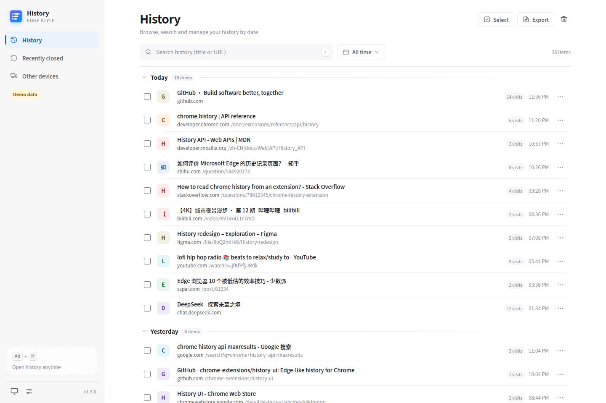
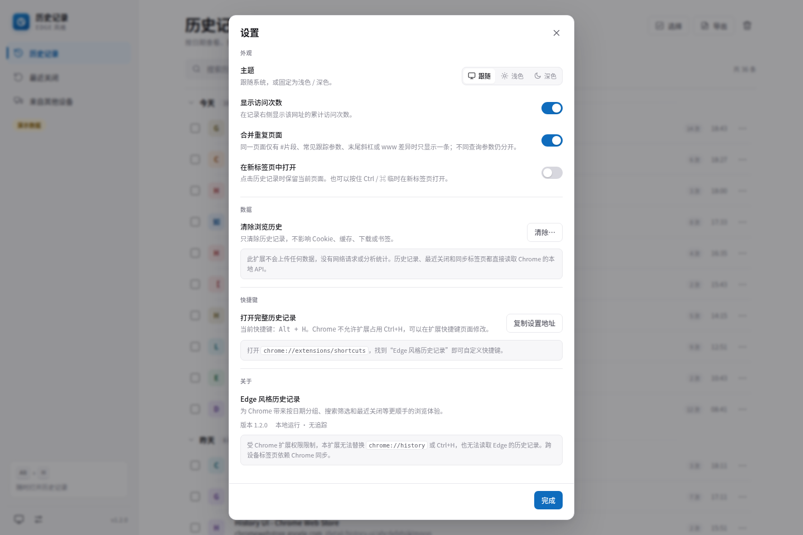
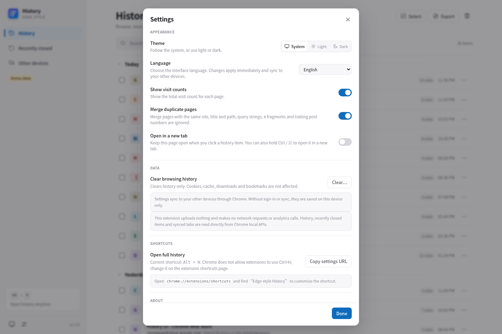

# Edge 风格历史记录（Chrome 扩展）

把 Edge 的历史记录体验带到 Chrome：**按日期分组、三视图搜索与时间筛选、最近关闭、跨设备标签页、导出、批量管理、访问明细**，并提供中文 / English 界面、Chrome 设置同步、选中文字右键搜索和地址栏 `hist` 入口。所有数据都在本机读取；没有服务器、网络请求或统计埋点。


## 1.3.0 更新

- **完整中英文界面**：跟随浏览器 / 简体中文 / English，标题、按钮、日期、星期、相对时间、数量、空状态、错误、确认框、toast、导出、设置和快捷键说明全部翻译；用户的历史标题和 URL 不会翻译。
- **设置同步**：主题、语言、显示访问次数、新标签页打开、合并重复页面、pageSize、欢迎提示等设置写入 `chrome.storage.sync`；不可用时回退到 `chrome.storage.local`，并从 1.2.0 的 local 设置自动迁移。
- **右键搜索**：选中文字后右键“在历史记录中搜索”，直接打开完整页的 `?q=...` 结果。
- **Omnibox**：地址栏输入 `hist` + 空格 + 关键词，最多 8 条“标题 + 域名”建议，回车打开完整历史页搜索。
- **分页修复**：同一 `lastVisitTime` 的记录超过一页时，自动扩大该时间边界的抓取量；300 条跨午夜并列数据现在可以全部加载。
- **回归工程**：19 个 CDP 测试、63 个 Node 单元测试、GitHub Actions 语法 / manifest / 打包校验；发布包仍未提交到仓库。

## 为什么做这个

Chrome 自带的历史记录页把记录平铺成一条很长的列表，缺少按天分组、最近关闭和跨设备入口。Edge 的 `edge://history` 在这些方面更顺手。这个扩展在 Chrome 里重建了类似的浏览体验：

- 分组浏览：今天 / 昨天 / 具体日期，日期分组可折叠、可粘性悬浮。
- 快速搜索：历史记录、最近关闭、来自其他设备三个视图都能按标题和网址即时过滤，命中词高亮；支持 `/` 聚焦搜索框。
- 时间筛选：全部时间、最近 1 小时、最近 24 小时、今天、昨天、最近 7 天、最近 30 天、自定义日期。
- 最近关闭：恢复单个标签页或整个窗口。
- 来自其他设备：显示通过 Chrome 同步打开的标签页（需要登录并开启同步）。
- 导出：CSV / JSON，支持全部历史或当前搜索/时间筛选；不申请下载权限。
- 合并重复页面：同一站点下标题相同、路径主体相同的记录合并为一条，访问次数累加；忽略查询参数、# 片段、末尾楼层数字和尾斜杠，可在设置中关闭。
- 管理：每行常显勾选、单条删除、按站点删除、多选批量删除、按时间范围清除历史。单条 / 按站点 / 批量删除确认后先隐藏记录，30 秒内可在提示中撤销，超时才真正删除；30 秒内关闭页面时，已过期的待删除会在下次打开时执行，未过期的取消。
- 更新提醒：启动时每天最多检查一次 GitHub Releases 的最新版本，有新版时在完整页顶部显示横幅，带下载链接，可按版本关闭提醒；离线或检查失败时静默跳过。演示模式用 `?update=1` 模拟一个新版本。
- 访问明细：查看某个网址的每次访问时间与来源类型。
- 浅色 / 深色 / 跟随系统，选择会被记住并同步。
- 工具栏快捷面板：按日期分组、可滚动的历史列表，支持时间筛选、搜索和“最近关闭”切换；滚动到底部自动加载更多。
- 性能：分页结果增量追加到已渲染列表，避免每页全量重建 DOM；日期组和行用 `content-visibility` 隔离离屏渲染，并用每组行数估算高度。

## 界面截图

| 中文界面 | English |
| --- | --- |
|  |  |
|  |  |
|  |  |
|  |  |
|  |  |
|  |  |
|  |  |

## 安装

1. 克隆本项目，或从 GitHub Releases 下载 `edge-history-for-chrome-1.3.0.zip` 后解压。`dist/` 是本地构建产物，不提交到仓库。
2. 打开 `chrome://extensions`。
3. 打开右上角的 **开发者模式**。
4. 点击 **加载已解压的扩展程序**，选择本项目根目录（包含 `manifest.json` 的目录）。
5. 点击浏览器工具栏中的扩展图标即可打开快捷面板；右键图标选择“固定”更方便。面板默认按日期显示可滚动的历史列表，不需要先跳到完整页面。

快捷键（可在 `chrome://extensions/shortcuts` 修改）：

- Windows / Linux：`Alt + H`
- macOS：`Option + Shift + H`

Chrome 不允许扩展接管内置的 `Ctrl + H`，所以本扩展提供独立的入口和快捷键。也可以把扩展页面固定为常用标签页。

## 使用

- **快捷面板**：点击工具栏图标，默认显示“今天 / 昨天 / 具体日期”分组的历史列表；滚动到底部自动加载更多，也可以点“加载更多”。顶部可切换到“最近关闭”。
- **打开完整页面**：快捷面板标题栏右侧的“完整页”按钮，或按快捷键。
- **搜索**：按 `/` 聚焦当前视图的搜索框，输入标题或网址关键词；`Enter` 打开第一条结果，`Esc` 清空/退出。历史记录、最近关闭、来自其他设备三个视图都支持。
- **筛选**：搜索框旁的“全部时间”菜单，可选最近 1 小时、最近 24 小时、今天、昨天、最近 7 天、最近 30 天；完整页面还支持自定义日期范围。
- **选择多条**：每行左侧的复选框常显，勾选任意一条会进入选择模式；右上角“选择”可以进入/退出，`Ctrl/Cmd + A` 全选已加载项，`Delete` 删除。
- **单条操作**：点击记录右侧常显的 `⋯`：在新标签页打开、复制链接、查看访问明细、删除此记录、删除整个站点的记录。
- **导出**：顶部“导出”按钮，选择“全部历史”或“当前搜索 / 时间筛选”，再选择 CSV 或 JSON；文件在本地生成，不上传。
- **最近关闭**：完整页面左侧“最近关闭”，或快捷面板顶部的“最近关闭”标签；每次进入都会刷新，点“恢复”或“恢复窗口”。
- **其他设备**：左侧“来自其他设备”，需要 Chrome 登录同一账号、开启同步，并在同步设置中勾选“打开的标签页”。空状态里有打开 Chrome 同步设置的入口。
- **清除历史**：右上角垃圾桶按钮，选择时间范围。弹窗会明确只有历史记录会被删除；Cookie、缓存、下载等可在弹窗里打开 Chrome 原生的“清除浏览数据”页面。
- **语言**：设置 → 外观 → 语言，选择“跟随浏览器 / 简体中文 / English”。切换后完整页立即更新；popup 下次打开或收到设置的 `storage.onChanged` 事件时更新。语言设置本身会随 Chrome 同步。
- **设置同步**：设置会优先写入 `chrome.storage.sync`。未登录 Chrome、同步被策略关闭或写入失败时，自动回退到 `chrome.storage.local`；同步不可用时设置页会明确提示。
- **右键搜索**：在任意网页选中文字，右键选择“在历史记录中搜索‘…’”；扩展会复用/聚焦已打开的完整历史页并搜索，不需要手动复制。
- **地址栏搜索**：输入 `hist`，按 Tab/空格后输入关键词；建议只显示标题和域名，不显示路径或查询参数。回车打开完整历史页 `?q=...`。

## 权限说明

| 权限 | 用途 |
| --- | --- |
| `history` | 读取、搜索和删除浏览历史（扩展的核心功能）。 |
| `sessions` | 读取“最近关闭”和 Chrome 同步的标签页/窗口。 |
| `tabs` | Chrome 只有在拥有 `tabs` 权限时，才会向扩展暴露会话标签页的标题和网址；同时用于聚焦已经打开的历史页面。 |
| `storage` | 保存并同步主题、语言、显示选项等设置；sync 不可用时回退到 local。 |
| `favicon` | 使用 Chrome 本地的 favicon 服务显示网站图标。 |
| `contextMenus` | 为选中的文字提供“在历史记录中搜索”的右键菜单。 |

没有 `host_permissions`，没有内容脚本，没有后台网络请求。最近关闭、同步标签页和历史记录全部直接通过 Chrome API 读取。

## 已知限制（重要）

这些限制来自 Chrome 扩展平台或当前实现范围：

1. **无法替换 `chrome://history` 或接管 `Ctrl + H`**。Chrome 不允许扩展覆盖内置页面和这个保留快捷键。本扩展提供自己的完整页面、工具栏面板和 `Alt + H` 快捷键。
2. **Chrome 的历史记录以网址为单位**。删除一条记录会删除该网址的**全部访问记录**，不能只删除某一次访问；访问明细页也只用于查看。单条 / 按站点 / 批量删除确认后有 30 秒撤销期（见上），真正执行后无法恢复；按时间范围“清除历史”没有撤销期，确认即删除。
3. **“来自其他设备”显示的是同步的“打开的标签页”，不是其他设备的完整历史记录**。Chrome 没有向扩展开放跨设备完整历史；同步未开启时该页为空。
4. **不会读取 Edge 的历史数据库**。这是一个在 Chrome 中复刻 Edge 浏览体验的独立扩展，不是 Edge → Chrome 的数据迁移工具。
5. **最近关闭依赖 Chrome 会话**，只保留最近 25 个关闭项；无痕窗口中的活动不会出现在普通会话列表中；还在加载中的标签页被关闭时不一定会进入会话列表。
6. 时间范围使用 Chrome 的 `history.search` 区间筛选：返回在范围内有访问的网址，每个网址显示范围内最近一次访问；同一天多次访问同一网址只显示一条，累计次数显示在右侧。
7. 清除历史只影响本机 Chrome 中保存的历史；同步到其他设备的数据是否同步删除，取决于 Chrome 的同步状态。
8. 本扩展默认不会在无痕模式启用；Chrome 的普通历史 API 也不包含无痕记录。
9. 扩展只清理浏览历史，不处理 Cookie、缓存、下载或书签；完整的“删除浏览数据”需要打开 Chrome 原生设置，无法嵌入扩展页面。
10. 完整页列表使用虚拟滚动：只渲染可视区上下各约 30 行，其余用占位高度撑起滚动条；数据仍按页抓取，抓取逻辑不变。极端情况下（单个 `lastVisitTime` 超过 5000 条）分页仍会受单次抓取上限限制。
11. 访问明细最多一次显示 300 次访问，避免超大访问列表卡死；总次数仍会显示。
12. 导出的 CSV/JSON 是本扩展自己的字段结构，不保证与 Edge 的导出文件逐字节一致。
13. “合并重复页面”按“同站点 + 同标题 + 路径主体”合并；不同标题或主体路径仍分开。完全相同的 URL 本来只返回一条。
14. **页面语言设置只控制扩展页面**。`manifest` 名称/描述、工具栏提示、右键菜单和 omnibox 文案由 Chrome 按浏览器 UI 语言加载，不能随页面里的“English / 简体中文”设置动态切换。中文页面 + 英文 Chrome UI 是可能出现的组合。
15. **Chrome 同步依赖登录状态**。`chrome.storage.sync` 在未登录时仍可作为本地同步区使用，但不会跨设备；被企业策略关闭或写入失败时回退到 local。设置数据很小，正常情况下远低于 sync 配额。
16. Omnibox 建议只显示标题和域名，避免把路径或查询参数暴露在地址栏下拉里；标题本身仍可能包含页面信息。
17. 自动化测试使用 Chrome for Testing 156。稳定版 Chrome 157 会忽略 `--load-extension`；headless 下真实 action popup 的高度固定为 500px，约 470px 的布局分支用 popup 页面视口测试覆盖，真实弹窗的 470px 高度需人工验证。

## 本地预览 / 开发

无需构建，直接加载目录即可。也可以在不安装扩展的情况下预览界面：

```bash
cd edge-history-for-chrome
python3 -m http.server 8765
```

打开：

- `http://127.0.0.1:8765/history.html?demo=1&lang=zh-CN` — 完整历史页（演示数据，中文）
- `http://127.0.0.1:8765/history.html?demo=1&lang=en` — English full page
- `http://127.0.0.1:8765/popup.html?demo=1&lang=zh-CN` — 工具栏面板（演示数据）
- 附加参数：`&view=closed`、`&view=devices`、`&theme=dark`、`&q=chrome`、`&settings=1`、`&welcome=1`、`&range=today|hour|24h|yesterday|7d|30d`、`&start=2026-11-01&end=2026-11-07`、`&lang=zh-CN|en`；`popup.html` 支持 `view=closed`、`q`、`range`、`lang`，`history.html` 支持全部参数。

测试夹具（仅 demo）：

- `&empty=1`：历史、最近关闭、其他设备全部为空。
- `&duplicates=1`：8 个 URL 变体合并成 3 行（访问次数 10 / 2 / 3）。
- `&count=300&tie=1`：300 条跨午夜、`lastVisitTime` 并列的记录。
- `&count=5000`：5000 条滚动加载数据。

`shared/demo.js` 只在 URL 带 `?demo=1` 且当前环境没有真实 `chrome.history` 时启用；在扩展页面中它会自动失效，不会覆盖真实 Chrome API。截图中的黄色“演示数据 / 演示”标识就是提示。

### 测试

使用 Chrome for Testing 156（稳定版 157 会忽略 `--load-extension`）：

```bash
export CHROME_BIN=/home/tiandc/.cache/ms-playwright/chromium-1248/chrome-linux64/chrome
NODE_USE_ENV_PROXY=0 node tests/run.mjs
node --test tests/unit/*.test.mjs
```

测试会用临时 `HOME` 和临时 `--user-data-dir`，不会接触真实 Chrome profile。当前覆盖：

- 中英文完整页 / popup 文案、日期、空状态和即时切换；
- `chrome.storage.sync` 写入、local 回退、1.2.0 local 设置迁移、跨页面 `onChanged`；
- 300 条跨午夜并列 `lastVisitTime` 全部加载；5000 条滚动加载；
- 重复页面合并开启 3 行 / 关闭 8 行；
- CSV/JSON 数量、CSV BOM / CRLF / 表头；
- 最近关闭重新进入强制刷新；
- popup 378×500、约 470px 视口无整窗外层滚动，以及真实 action popup 378×500；
- 右键菜单存在性、查询路由、omnibox 关键字和建议构造；
- DST 时区（America/New_York）日期边界。

CI 见 `.github/workflows/ci.yml`：语法、manifest / locale 校验、33 个单元测试和 zip 打包在每次 push / PR 运行；CDP 测试不默认下载浏览器，设置 `RUN_CDP_TESTS=1` 和 `CHROME_BIN` 后才运行。

### 构建与校验

```bash
node tools/validate.mjs
node tools/build.mjs
```

`tools/build.mjs` 读取 `manifest.json` 版本，生成 `dist/edge-history-for-chrome-<version>/` 和 `dist/edge-history-for-chrome-<version>.zip`；zip 内含 LICENSE 和 `_locales`，不含 tests/tools/screenshots/dist。`dist/` 被 `.gitignore` 忽略。

### 截图

```bash
# 需要先启动本地静态服务器
node tools/cdp-shot.mjs "http://127.0.0.1:8765/history.html?demo=1&lang=zh-CN" screenshots/history-light.png "" 1440 960
node tools/cdp-shot.mjs "http://127.0.0.1:8765/history.html?demo=1&lang=en&settings=1" screenshots/settings-en.png "" 1440 960
```

`tools/cdp-shot.mjs` 默认使用 Chrome for Testing 156，也可以用 `CHROME_BIN` 覆盖；每次使用临时 HOME / profile。

其他开发命令：

```bash
# 重新生成多尺寸图标（需要 Pillow）
python3 tools/make_icons.py

# 连接已开启 remote debugging 的 Chrome，检查扩展页面
node tools/cdp-live.mjs 9333 "chrome-extension://<id>/history.html" "document.title"
```

## 项目结构

```text
edge-history-for-chrome/
├── manifest.json          # Manifest V3；default_locale + __MSG__ 本地化
├── background.js          # 设置迁移、右键菜单、omnibox、快捷键、欢迎页
├── history.html/css/js    # 完整历史记录页面
├── popup.html/css/js      # 工具栏快捷面板（日期分组、滚动加载）
├── theme-boot.js          # 首屏前恢复主题和 lang，避免闪白
├── _locales/              # en / zh_CN 的 manifest 文案
├── shared/
│   ├── i18n.js            # 中英文字典、占位符、复数、data-i18n
│   ├── settings.js        # sync/local 设置、迁移、onChanged
│   ├── pagination.js      # 处理 lastVisitTime 并列的分页
│   ├── search.js          # 右键/omnibox 查询与建议构造
│   ├── utils.js           # Intl 日期、URL、格式化
│   ├── icons.js           # 本地 SVG 图标 sprite
│   └── demo.js            # ?demo=1 离线演示数据与测试夹具
├── icons/                 # 16/24/32/48/128/256 PNG 与源 SVG
├── screenshots/           # README 截图（中文 + English）
├── tests/                 # Node CDP 回归 + 单元测试
├── tools/                 # 构建、校验、截图、图标工具
└── .github/workflows/     # CI：语法 / 校验 / 单元测试 / 打包
```

## 已验证的行为

使用 Chrome for Testing 156 加载未打包扩展，并用 Node CDP（无第三方测试框架）验证：

- `chrome.history.search` 在新版 Chrome 中要求 `text` 字段存在（即使为空字符串），已处理。
- 仅有 `sessions` 权限时，最近关闭标签页只返回 `sessionId`；加入 `tabs` 权限后才会返回标题和网址，已处理。
- `sessions` 的 `lastModified` 可能以秒为单位返回，已统一归一化为毫秒。
- 单个标签页和整个窗口的恢复、删除历史、搜索、时间筛选、自定义日期范围、批量删除和清除范围均已跑通。
- 工具栏面板以真实 action popup 打开时外框为 **380 × 500**、内容区为 **378 × 500**；Chrome 只提供约 470px 高度时自动收缩，不出现整窗滚动条。回归套件用真实 action popup 验证 378×500，用 popup 页面 378×470 视口验证矮视口分支。
- 工具栏面板按日期分组、时间筛选、搜索、最近关闭切换和滚动加载均已跑通；在 300 / 5000 条测试记录下可以连续加载到全部记录，没有漏项。
- 完整页和工具栏面板都会过滤扩展自己的页面，避免每次打开历史页都把历史页本身写进列表；同时修复了 100 条以上记录的分页漏项，以及删光当前已加载项后误报“没有历史记录”的问题。
- 在同一 `lastVisitTime` 并列的跨天数据上验证 300 / 300 条全部加载；5000 条合成历史下完整页约 **7.7s** 加载全部（CDP 回归环境，包含分页等待；加载耗时主要由测试的轮询间隔决定，虚拟滚动后渲染的 DOM 行数保持在约 100 行以内，实测 42 行）。
- 真实 Chrome 中同一 URL 访问 5 次，再加 `?q=1`、#、utm、尾斜杠变体：开启合并后只显示 2 行、该页访问次数为 9；关闭合并后恢复为 6 行。1.3.0 的测试夹具另外验证了 8 个变体合并为 3 行（10/2/3 次）、关闭后 8 行。
- CSV/JSON 导出走了真实 Blob 下载链路：CSV 带 UTF-8 BOM、CRLF 和公式注入保护；JSON 可解析，导出行数与 UI 一致。回归测试验证 CSV 表头 + 36 行、JSON count/items = 36。
- 最近关闭重新进入会 force 刷新；设置→清除不再有延迟弹窗竞态；popup tab 支持方向键，行菜单支持方向键和焦点恢复。
- 在 DST 时区（America/New_York）验证了昨天/7 天/自定义范围的日界，跨夏令时不会多算或少算 1 小时；单元测试覆盖 23h / 25h 日长。
- 设置从 1.2.0 的 local 迁移到 sync；完整页和 popup 通过 `chrome.storage.onChanged` 实时同步语言/主题；sync 读失败和写失败回退 local 的单元测试通过。
- 英文模式下完整页、popup、设置、清除、导出、最近关闭和其他设备视图没有中文 UI 残留；manifest 名称、action 标题、命令描述在英文/中文 Chrome UI 下分别正确加载。
- 右键菜单项通过 `chrome.contextMenus.update` 验证存在；选中文字查询通过后台同款 runtime message 路由验证会更新已打开完整页的 `?q=`。Omnibox 的 `hist` 关键字、默认建议和标题+域名建议构造有单元测试；实际地址栏下拉属于 Chrome UI，建议手动体验。
- “来自其他设备”在无同步账号的环境下会正确显示引导空状态。
- CI：语法、JSON、manifest/_locales 校验、63 个单元测试、1.3.0 zip 打包；CDP 套件本地运行 19/19 通过。

## 版本

当前版本：`1.3.0`。个人使用的本地扩展；没有上传 Chrome Web Store。发布包通过 GitHub Releases 分发。

## 许可证

本项目采用 [MIT License](LICENSE)。
