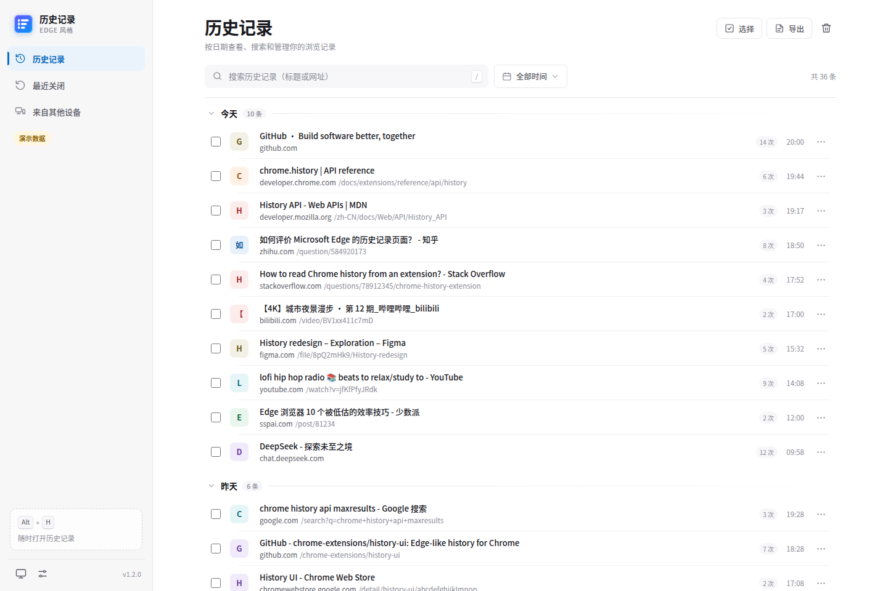
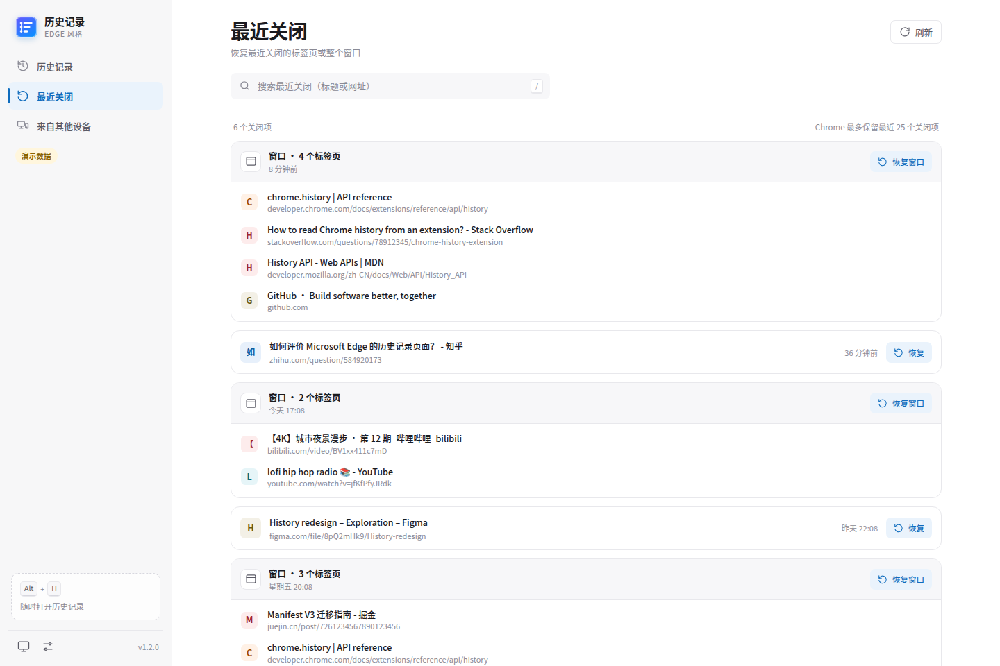
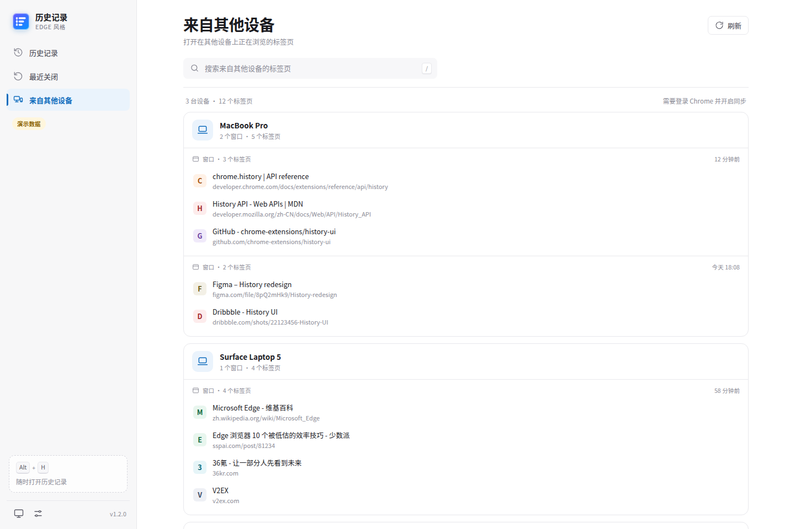
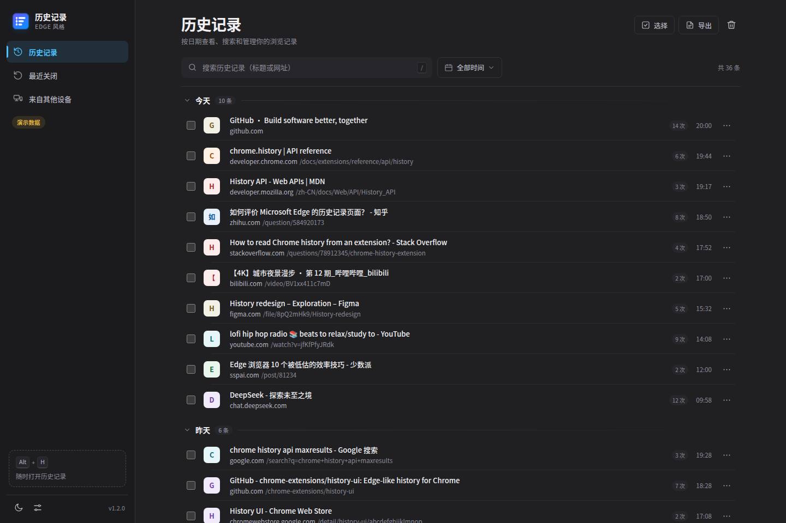
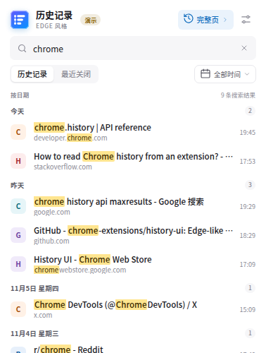
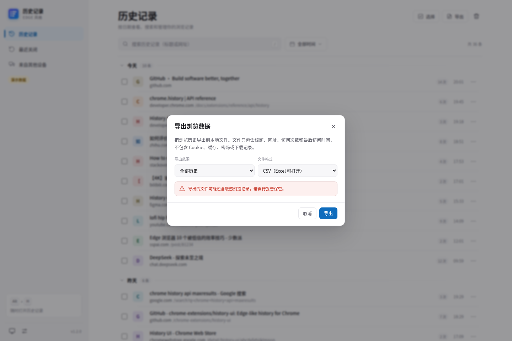
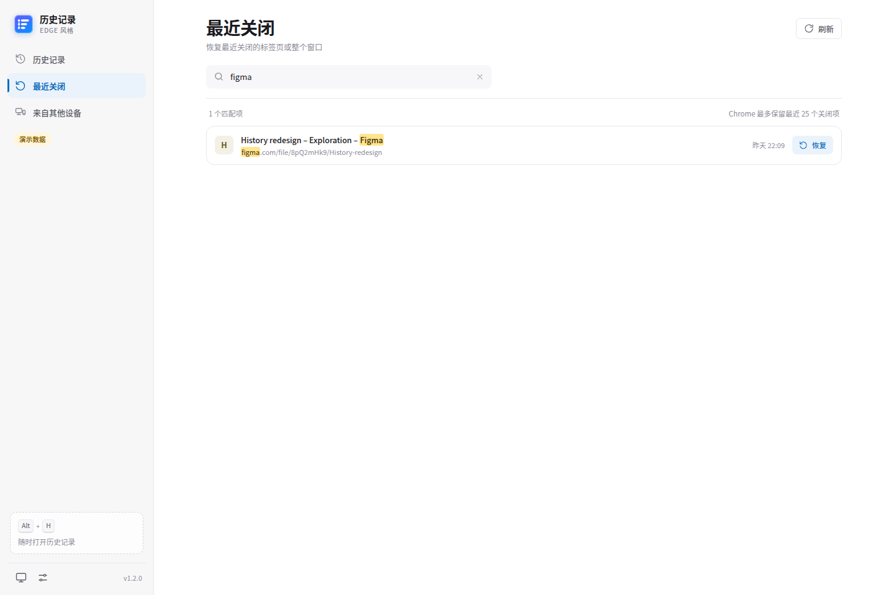

# Edge 风格历史记录（Chrome 扩展）

把 Edge 的历史记录体验带到 Chrome：**按日期分组、三视图搜索与时间筛选、最近关闭、跨设备标签页、导出、批量管理、访问明细**。所有数据都在本机读取，没有服务器、网络请求或统计埋点。



## 为什么做这个

Chrome 自带的历史记录页把记录平铺成一条很长的列表，缺少按天分组、最近关闭和跨设备入口。Edge 的 `edge://history` 在这些方面更顺手。这个扩展在 Chrome 里重建了类似的浏览体验：

- 分组浏览：今天 / 昨天 / 具体日期，日期分组可折叠、可粘性悬浮。
- 快速搜索：历史记录、最近关闭、来自其他设备三个视图都能按标题和网址即时过滤，命中词高亮；支持 `/` 聚焦搜索框。
- 时间筛选：全部时间、最近 1 小时、最近 24 小时、今天、昨天、最近 7 天、最近 30 天、自定义日期。
- 最近关闭：恢复单个标签页或整个窗口。
- 来自其他设备：显示通过 Chrome 同步打开的标签页（需要登录并开启同步）。
- 导出：CSV / JSON，支持全部历史或当前搜索/时间筛选；不申请下载权限。
- 合并重复页面：同一站点下标题相同、路径主体相同的记录合并为一条，访问次数累加；忽略查询参数、# 片段、末尾楼层数字和尾斜杠，可在设置中关闭。
- 管理：每行常显勾选、单条删除、按站点删除、多选批量删除、按时间范围清除历史。
- 访问明细：查看某个网址的每次访问时间与来源类型。
- 浅色 / 深色 / 跟随系统，选择会被记住。
- 工具栏快捷面板：按日期分组、可滚动的历史列表，支持时间筛选、搜索和“最近关闭”切换；滚动到底部自动加载更多。
- 性能：分页结果增量追加到已渲染列表，避免每页全量重建 DOM；日期组和行用 `content-visibility` 隔离离屏渲染，并用每组行数估算高度。

| 最近关闭 | 来自其他设备 |
| --- | --- |
|  |  |

| 深色模式 | 工具栏面板 |
| --- | --- |
|  |  |

| 工具栏滚动（按日期） | 工具栏搜索 | 工具栏最近关闭 |
| --- | --- | --- |
|  |  |  |

| 导出浏览数据 | 最近关闭搜索 |
| --- | --- |
|  |  |

## 安装

1. 克隆本项目，或从 GitHub Releases 下载 `edge-history-for-chrome-1.2.0.zip` 后解压。`dist/` 是本地构建产物，不提交到仓库。
2. 打开 `chrome://extensions`。
3. 打开右上角的 **开发者模式**。
4. 点击 **加载已解压的扩展程序**，选择本项目根目录（包含 `manifest.json` 的目录）。
5. 点击浏览器工具栏中的扩展图标即可打开快捷面板；右键图标选择“固定”更方便。面板默认按日期显示可滚动的历史列表，不需要先跳到完整页面。

快捷键（可在 `chrome://extensions/shortcuts` 修改）：

- Windows / Linux：`Alt + H`
- macOS：`Option + Shift + H`

Chrome 不允许扩展接管内置的 `Ctrl + H`，所以本扩展提供独立的入口和快捷键。也可以把扩展页面固定为常用标签页。

## 使用

- **快捷面板**：点击工具栏图标，默认显示“今天 / 昨天 / 具体日期”分组的历史列表；滚动到底部自动加载更多，也可以点“加载更多”。顶部可切换到“最近关闭”。
- **打开完整页面**：快捷面板标题栏右侧的“完整页”按钮，或按快捷键。
- **搜索**：按 `/` 聚焦当前视图的搜索框，输入标题或网址关键词；`Enter` 打开第一条结果，`Esc` 清空/退出。历史记录、最近关闭、来自其他设备三个视图都支持。
- **筛选**：搜索框旁的“全部时间”菜单，可选最近 1 小时、最近 24 小时、今天、昨天、最近 7 天、最近 30 天；完整页面还支持自定义日期范围。
- **选择多条**：每行左侧的复选框常显，勾选任意一条会进入选择模式；右上角“选择”可以进入/退出，`Ctrl/Cmd + A` 全选已加载项，`Delete` 删除。
- **单条操作**：点击记录右侧常显的 `⋯`：在新标签页打开、复制链接、查看访问明细、删除此记录、删除整个站点的记录。
- **导出**：顶部“导出”按钮，选择“全部历史”或“当前搜索 / 时间筛选”，再选择 CSV 或 JSON；文件在本地生成，不上传。
- **最近关闭**：完整页面左侧“最近关闭”，或快捷面板顶部的“最近关闭”标签；每次进入都会刷新，点“恢复”或“恢复窗口”。
- **其他设备**：左侧“来自其他设备”，需要 Chrome 登录同一账号、开启同步，并在同步设置中勾选“打开的标签页”。空状态里有打开 Chrome 同步设置的入口。
- **清除历史**：右上角垃圾桶按钮，选择时间范围。弹窗会明确只有历史记录会被删除；Cookie、缓存、下载等可在弹窗里打开 Chrome 原生的“清除浏览数据”页面。

## 权限说明

| 权限 | 用途 |
| --- | --- |
| `history` | 读取、搜索和删除浏览历史（扩展的核心功能）。 |
| `sessions` | 读取“最近关闭”和 Chrome 同步的标签页/窗口。 |
| `tabs` | Chrome 只有在拥有 `tabs` 权限时，才会向扩展暴露会话标签页的标题和网址；同时用于聚焦已经打开的历史页面。 |
| `storage` | 保存主题、显示选项等本地设置。 |
| `favicon` | 使用 Chrome 本地的 favicon 服务显示网站图标。 |

没有 `host_permissions`，没有内容脚本，没有后台网络请求。最近关闭、同步标签页和历史记录全部直接通过 Chrome API 读取。

## 已知限制（重要）

这些限制来自 Chrome 扩展平台或当前实现范围：

1. **无法替换 `chrome://history` 或接管 `Ctrl + H`**。Chrome 不允许扩展覆盖内置页面和这个保留快捷键。本扩展提供自己的完整页面、工具栏面板和 `Alt + H` 快捷键。
2. **Chrome 的历史记录以网址为单位**。删除一条记录会删除该网址的**全部访问记录**，不能只删除某一次访问；访问明细页也只用于查看。删除无法撤销。
3. **“来自其他设备”显示的是同步的“打开的标签页”，不是其他设备的完整历史记录**。Chrome 没有向扩展开放跨设备完整历史；同步未开启时该页为空。
4. **不会读取 Edge 的历史数据库**。这是一个在 Chrome 中复刻 Edge 浏览体验的独立扩展，不是 Edge → Chrome 的数据迁移工具。
5. **最近关闭依赖 Chrome 会话**，只保留最近 25 个关闭项；无痕窗口中的活动不会出现在普通会话列表中。
6. 时间范围使用 Chrome 的 `history.search` 区间筛选：返回在范围内有访问的网址，每个网址显示范围内最近一次访问；同一天多次访问同一网址只显示一条，累计次数显示在右侧。
7. 清除历史只影响本机 Chrome 中保存的历史；同步到其他设备的数据是否同步删除，取决于 Chrome 的同步状态。
8. 本扩展默认不会在无痕模式启用；Chrome 的普通历史 API 也不包含无痕记录。
9. 扩展只清理浏览历史，不处理 Cookie、缓存、下载或书签；完整的“删除浏览数据”需要打开 Chrome 原生设置，无法嵌入扩展页面。
10. 列表按页加载并把新页增量追加到 DOM，没有使用虚拟滚动；数万条历史下性能仍会低于 Edge 的原生列表。
11. 访问明细最多一次显示 300 次访问，避免超大访问列表卡死；总次数仍会显示。
12. 导出的 CSV/JSON 是本扩展自己的字段结构，不保证与 Edge 的导出文件逐字节一致。
13. “合并重复页面”按“同站点 + 同标题 + 路径主体”合并；不同标题或主体路径仍分开。完全相同的 URL 本来只返回一条。

## 本地预览 / 开发

无需构建，直接加载目录即可。也可以在不安装扩展的情况下预览界面：

```bash
cd edge-history-for-chrome
python3 -m http.server 8765
```

打开：

- `http://127.0.0.1:8765/history.html?demo=1` — 完整历史页（演示数据）
- `http://127.0.0.1:8765/popup.html?demo=1` — 工具栏面板（演示数据，默认显示按日期分组的历史）
- 附加参数：`&view=closed`、`&view=devices`、`&theme=dark`、`&q=chrome`、`&settings=1`、`&welcome=1`、`&range=today|hour|24h|yesterday|7d|30d`、`&start=2026-11-01&end=2026-11-07`；`popup.html` 支持 `view=closed`、`q`、`range`，`history.html` 支持全部参数。

`shared/demo.js` 只在 URL 带 `?demo=1` 且当前环境没有真实 `chrome.history` 时启用；在扩展页面中它会自动失效，不会覆盖真实 Chrome API。截图中的黄色“演示数据 / 演示”标识就是提示。

其他开发命令：

```bash
# 重新生成多尺寸图标（需要 Pillow）
python3 tools/make_icons.py

# 用无头 Chrome 截图（可传入一段在页面里执行的 JS）
node tools/cdp-shot.mjs "http://127.0.0.1:8765/history.html?demo=1" screenshots/history-light.png "" 1440 960

# 连接已开启 remote debugging 的 Chrome，检查扩展页面
node tools/cdp-live.mjs 9333 "chrome-extension://<id>/history.html" "document.title"
```

## 项目结构

```text
edge-history-for-chrome/
├── manifest.json          # Manifest V3
├── background.js          # 安装默认值、快捷键、欢迎页
├── history.html/css/js    # 完整历史记录页面
├── popup.html/css/js      # 工具栏快捷面板（日期分组、滚动加载）
├── theme-boot.js          # 首屏前恢复主题，避免闪白
├── shared/
│   ├── utils.js           # 日期、URL、格式化和设置工具
│   ├── icons.js           # 本地 SVG 图标 sprite
│   └── demo.js            # 仅 ?demo=1 时启用的离线演示数据
├── icons/                 # 16/24/32/48/128/256 PNG 与源 SVG
├── screenshots/           # README 截图
└── tools/                 # 图标生成和 CDP 调试脚本
```

## 已验证的行为

使用 Chrome for Testing 156 加载未打包扩展，并通过 CDP 做了真实 API 验证：

- `chrome.history.search` 在新版 Chrome 中要求 `text` 字段存在（即使为空字符串），已处理。
- 仅有 `sessions` 权限时，最近关闭标签页只返回 `sessionId`；加入 `tabs` 权限后才会返回标题和网址，已处理。
- `sessions` 的 `lastModified` 可能以秒为单位返回，已统一归一化为毫秒。
- 单个标签页和整个窗口的恢复、删除历史、搜索、时间筛选、自定义日期范围、批量删除和清除范围均已跑通。
- 工具栏面板以真实 action popup 打开时外框为 **380 × 500**、内容区为 **378 × 500**；Chrome 只提供约 470px 高度时会自动收缩到视口，不出现整窗滚动条。顶部筛选和“完整页”入口可见，底部完全留给列表滚动。
- 工具栏面板按日期分组、时间筛选、搜索、最近关闭切换和滚动加载均已跑通；在 300 / 5000 条测试记录下可以连续加载到全部记录，没有漏项。
- 完整页和工具栏面板都会过滤扩展自己的页面，避免每次打开历史页都把历史页本身写进列表；同时修复了 100 条以上记录的分页漏项，以及删光当前已加载项后误报“没有历史记录”的问题。
- 在同一 `lastVisitTime` 并列的跨天数据上验证 300 / 300 条全部加载，无重复；5000 条合成历史下完整页和 popup 都能滚动到全部记录。
- 真实 Chrome 中同一 URL 访问 5 次，再加 `?q=1`、#、utm、尾斜杠变体：开启合并后只显示 2 行、该页访问次数为 9；关闭合并后恢复为 6 行。删除合并记录会连同全部变体一起删除。
- CSV/JSON 导出走了真实 Blob 下载链路：CSV 带 UTF-8 BOM、CRLF 和公式注入保护；JSON 可解析，导出行数与 UI 一致。
- 最近关闭重新进入会 force 刷新；设置→清除不再有延迟弹窗竞态；popup tab 支持方向键，行菜单支持方向键和焦点恢复。
- 在 DST 时区（America/New_York）验证了昨天/7 天/自定义范围的日界，跨夏令时不会多算或少算 1 小时。
- 性能对比（Chrome for Testing 156，同一临时 profile 结构）：800 条时完整页滚动加载约 0.58s（旧版约 1.06s），popup 约 1.03s（旧版约 1.25s）；5000 条完整页约 4.0s、popup 约 7.0s；20k 条完整页加载全部约 45s（旧版 20k 约 848s，测试脚本不同，仅作量级参考）。数字受机器、缓存和网络影响。
- 在无同步账号的环境下，“来自其他设备”会正确显示引导空状态。

## 版本

当前版本：`1.2.0`。个人使用的本地扩展；没有上传 Chrome Web Store。
